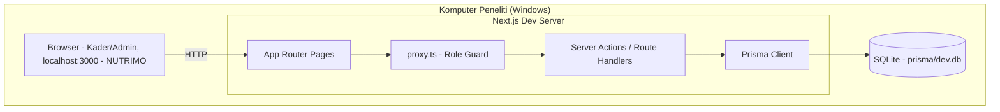
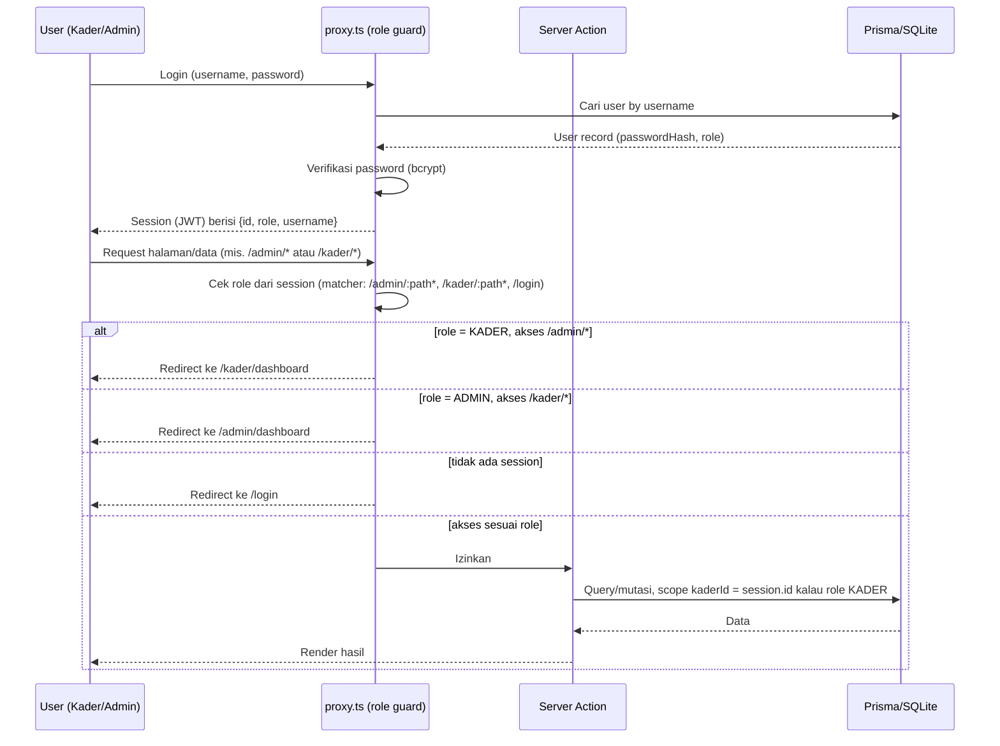
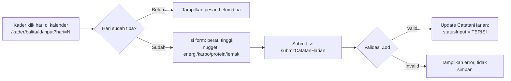
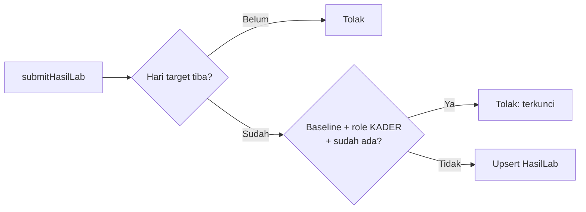

# Architecture — NUTRIMO (Nuget Nutrition Monitoring)

> **Update:** stack & struktur folder di sini mengikuti implementasi aktual di
> `D:\projek\balitaFeed`, sudah berbeda dari rencana awal (lihat catatan di tiap bagian). Nama
> aplikasi yang ditampilkan ke user sekarang **NUTRIMO** — nama folder/package proyek
> (`balita-feed`) tidak diganti, ini murni rebrand tampilan (title tab, sidebar, halaman login).

> **Update 18 Okt 2026 — form input balita disederhanakan:** hanya 6 field (nama, usia, jenis kelamin,
> tinggi badan, berat badan, kader penanggung jawab). Field kontak, wilayah, posyandu, dan riwayat
> pemeriksaan sudah tidak diisi lagi; data lama tetap tersimpan dan tampil read-only.

## 1. Tech Stack (aktual)

| Layer | Pilihan | Perubahan dari rencana awal |
|---|---|---|
| Framework | **Next.js 16.3.4 (App Router)** | Rencana awal "14+"; Next 16 punya breaking change: `middleware.ts` → `proxy.ts`, `params`/`searchParams` jadi `Promise` (async) |
| Bahasa | TypeScript 5 | tidak berubah |
| ORM | **Prisma 6.19.3** (pinned exact, bukan `^`) | Prisma 7 mengubah cara baca `url` datasource (butuh `prisma.config.ts` + driver adapter) — sengaja **tidak** dipakai supaya setup tetap simpel |
| Database | **SQLite lokal** (`prisma/dev.db`) | Rencana awal Postgres (Neon/Supabase). Diganti ke SQLite lokal untuk kebutuhan skripsi (tanpa provisioning cloud DB, jalan penuh di laptop). Konsekuensi: semua `enum` di schema.md jadi `String` yang divalidasi Zod, bukan Prisma enum native |
| Auth | **NextAuth v5 (beta) — Credentials Provider** | Sesuai rencana; session JWT, role (`ADMIN`/`KADER`) disisipkan di token |
| UI | **Tailwind CSS v4** (tanpa shadcn/ui) | Rencana awal shadcn/ui — diganti komponen UI custom ringan (`src/components/ui.tsx`: `Button`, `Input`, `Select`, `Card`, `Badge`, dst.) supaya dependency lebih sedikit |
| Chart | **Recharts** | Sesuai rencana — `TrendChart` generic component untuk tren BB & TB |
| Validasi | **Zod v4** | Ditambahkan (belum eksplisit di rencana awal) — skema di `src/lib/validators.ts` |
| Export | **PapaParse** (CSV) | Rencana awal exceljs/SheetJS — diganti CSV polos (PapaParse) karena SPSS/Excel bisa baca CSV langsung, lebih ringan |
| Deployment | **Server sendiri (cPanel Node.js / Passenger)** + PostgreSQL | Bukan Vercel. Entry point `server.js`; build pakai `schema.production.prisma` — lihat §8. Dev lokal tetap SQLite (`npm run dev`) |

## 2. System Architecture (aktual — jalan lokal)



## 3. Auth & Authorization Flow



**Prinsip scoping (tidak berubah, defense in depth):** setiap Server Action untuk role Kader
selalu memfilter berdasarkan `kaderId = session.user.id` di level query — bukan hanya
disembunyikan di UI. Ini dicek eksplisit misalnya di `getScopedBalitaOrThrow` (`catatan-harian.actions.ts`)
dan di `submitHasilLab`.

**Label UI "SPV Kader":** role `ADMIN` di database & di URL (`/admin/*`) tidak diganti — hanya
teks yang ditampilkan ke user (mis. judul halaman, pesan error `requireAdmin()`) yang memakai
label "SPV Kader" alih-alih "Admin".

**Nama aplikasi "NUTRIMO":** diterapkan di 3 tempat tampilan — `<title>` tab browser
(`src/app/layout.tsx`), sidebar/header `AppShell` (`src/components/AppShell.tsx`), dan halaman
login (`src/app/login/page.tsx`). Tidak mengubah struktur folder, nama package (`package.json`
`name` tetap `balita-feed`), atau URL apapun.

## 4. Folder Structure (aktual)

```
balita-feed/                          # nama folder/package tidak diganti (lihat catatan di atas)
├── prisma/
│   ├── schema.prisma                # SQLite (dev lokal)
│   ├── schema.production.prisma     # PostgreSQL (produksi, enum asli)
│   └── seed.ts                      # seed kosong: 1 admin + 4 kader, TANPA balita/catatan
│                                     # dummy — supaya kader bisa dites dari kondisi awal asli
├── src/
│   ├── app/
│   │   ├── login/page.tsx           # "NUTRIMO"
│   │   ├── admin/                   # folder biasa (BUKAN route group (admin) — lihat catatan)
│   │   │   ├── layout.tsx
│   │   │   ├── dashboard/page.tsx   # agregat semua balita
│   │   │   ├── balita/
│   │   │   │   ├── page.tsx         # list & tambah balita
│   │   │   │   └── [id]/page.tsx    # detail + form input (admin)
│   │   │   ├── kader/page.tsx       # kelola akun kader (add/update/delete)
│   │   │   └── export/page.tsx      # export CSV
│   │   ├── kader/                   # folder biasa (BUKAN route group (kader))
│   │   │   ├── layout.tsx
│   │   │   ├── dashboard/page.tsx   # list balita miliknya
│   │   │   └── balita/[id]/
│   │   │       ├── page.tsx         # detail + kalender / dashboard
│   │   │       └── input/page.tsx   # input harian (hari ke-2 dst.)
│   │   └── api/
│   │       ├── auth/[...nextauth]/route.ts
│   │       └── export/
│   │           ├── harian/route.ts
│   │           └── ringkasan/route.ts
│   ├── actions/                     # Server Actions
│   │   ├── auth.actions.ts
│   │   ├── balita.actions.ts        # createBalita, updateBalita, updateBalitaStatus, deleteBalita,
│   │   │                             # createKader, updateKader, deleteKader
│   │   ├── catatan-harian.actions.ts
│   │   ├── hasil-lab.actions.ts     # lab: baru bisa diisi setelah harinya tiba (rule.md §7)
│   │   └── signout.action.ts
│   ├── lib/
│   │   ├── prisma.ts
│   │   ├── constants.ts             # ROLES, TIPE_LAB, HARI_LAB, LABEL_LAB, dll.
│   │   ├── validators.ts            # semua Zod schema
│   │   ├── data.ts                  # isSameDay, todayCatatan
│   │   └── utils.ts                 # formatTanggal, complianceRate, delta, cn
│   ├── components/
│   │   ├── ui.tsx                   # Button, Input, Select, Card, Badge, Label, dst.
│   │   ├── AppShell.tsx             # bottom nav (mobile) / sidebar (desktop) — "NUTRIMO"
│   │   ├── BalitaForm.tsx           # form Tambah Balita (6 field, memakai BalitaFields)
│   │   ├── BalitaStatusForm.tsx
│   │   ├── CatatanHarianForm.tsx    # input harian (hari ke-2 dst.)
│   │   ├── HasilLabForm.tsx         # 1 tipe lab per render
│   │   ├── KaderForm.tsx / KaderRow.tsx / KaderEditForm.tsx / KaderDeleteButton.tsx
│   │   ├── BalitaFields.tsx         # 6 field form balita (dipakai Tambah & Edit)
│   │   ├── BalitaEditForm.tsx       # form Edit Profil balita (admin)
│   │   ├── TrendChart.tsx
│   │   ├── LoginForm.tsx
│   │   └── icons.tsx
│   ├── proxy.ts                     # role guard (dulu middleware.ts di Next <16)
│   └── types/next-auth.d.ts         # augmentasi type session.user (id, role, username)
├── server.js                         # entry point produksi (cPanel/Passenger)
├── .env                              # DATABASE_URL, NEXTAUTH_SECRET
├── .gitignore
└── package.json                      # "name": "nutrimo" (cosmetic, tidak wajib reinstall)
```

> **Kenapa bukan route group `(admin)`/`(kader)`:** rencana awal pakai route group
> `(admin)/balita/[id]/page.tsx` dan `(kader)/balita/[id]/page.tsx` — tapi route group **tidak
> muncul di URL**, jadi dua-duanya resolve ke URL yang sama (`/balita/[id]`) dan bentrok. Sudah
> diganti jadi folder biasa `admin/` dan `kader/` sehingga URL-nya beda (`/admin/balita/[id]` vs
> `/kader/balita/[id]`).

## 5. Data Flow: Input Harian (hari mana pun yang sudah tiba) — kader



## 6. Data Flow: Hasil Lab (Baseline terkunci)



## 7. Fitur Dihapus: Dropdown Wilayah Administratif

Dropdown Provinsi → Kab/Kota → Kecamatan → Desa/Kel (proxy `/api/wilayah/**` ke
`emsifa/api-wilayah-indonesia`) **dihapus pada 18 Okt 2026** karena form balita disederhanakan
dan field wilayah tidak diinput lagi. File yang dihapus: `WilayahSelect.tsx`, `lib/wilayah.ts`,
`lib/wilayah-server.ts`, dan seluruh `src/app/api/wilayah/`. Kolom wilayah di tabel `Balita`
tetap ada untuk data lama.

## 8. Deployment Produksi (server sendiri, bukan Vercel)

- **Hosting:** server cPanel (Setup Node.js App / Passenger). Entry point `server.js`, yang juga
  memuat penyesuaian khusus server (batas thread/CPU affinity).
- **Database:** PostgreSQL, memakai `prisma/schema.production.prisma`. Build:
  `npm run build:prod` (generate client produksi + `next build`). Perubahan schema:
  `npm run db:push:prod` atau SQL manual.
- **Update 18 Okt 2026 (form balita ringkas):** jalankan SQL di
  `migration-posyandu-nullable.sql` (`ALTER TABLE "Balita" ALTER COLUMN "posyandu" DROP NOT NULL;`)
  **sebelum** menjalankan versi kode baru, lalu build ulang, upload, dan restart Node.js App.
  Data balita lama tidak berubah. Urutan ini penting: kode baru tidak lagi mengirim `posyandu`,
  sehingga insert gagal kalau kolom masih `NOT NULL`.
- **Dev lokal:** SQLite (`prisma/dev.db`), `npm run dev`, `npm run db:push`.

## 9. Non-Functional Considerations

- **Mobile-first**: `AppShell` pakai bottom nav di mobile (`md:hidden`), sidebar di desktop
  (`hidden md:flex`) — sesuai permintaan awal "utamakan tampilan mobile, bertahap sampai desktop".
- **Offline resilience**: masih di luar scope untuk data harian/lab.
- **Backup data**: dev lokal = copy `prisma/dev.db`. Produksi = dump PostgreSQL (`pg_dump`) sebelum
  setiap perubahan schema; belum ada mekanisme otomatis.